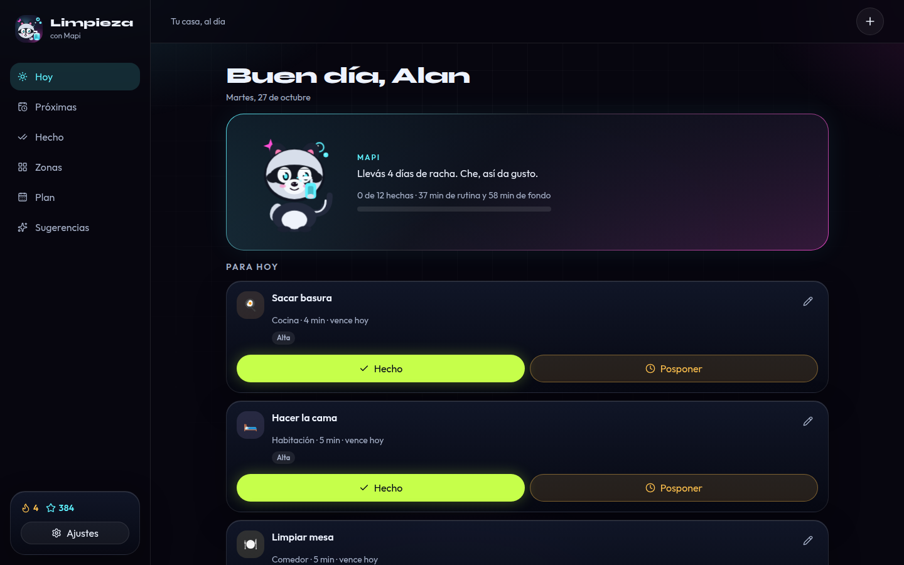
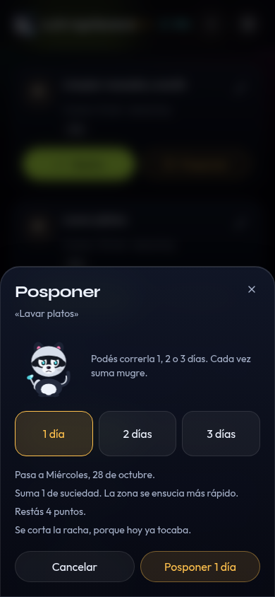
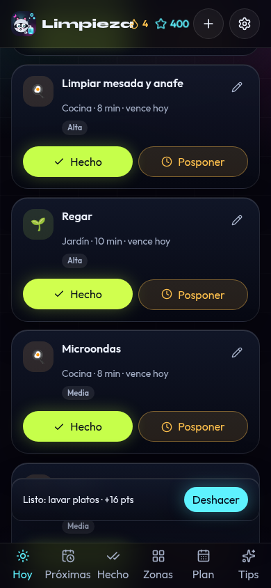
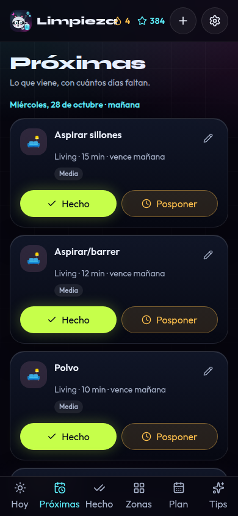
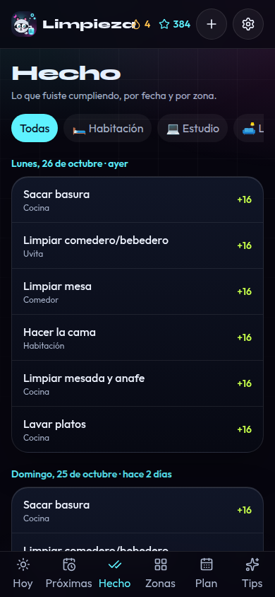
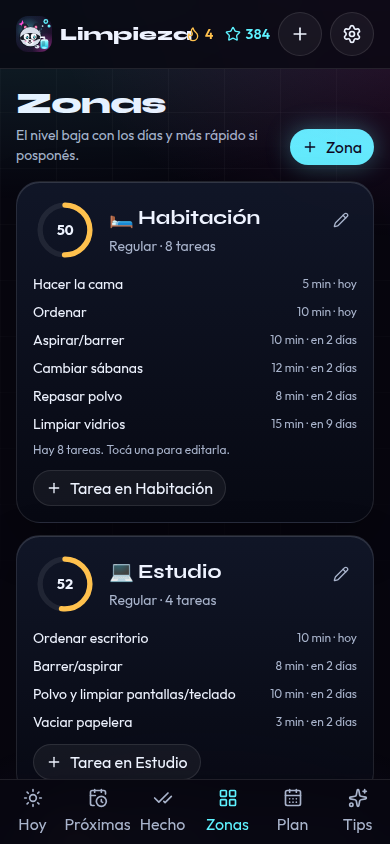
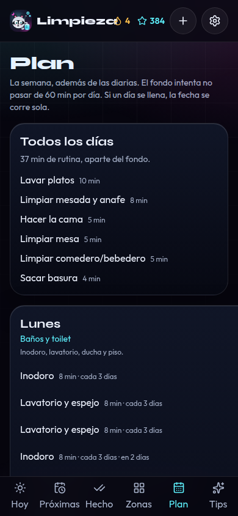

# Limpieza del hogar

App para planificar y controlar la limpieza de la casa de Alan Pereyra. La interfaz está en español rioplatense. Los datos quedan en el navegador: no hay backend ni servicios pagos.

Cuando el repositorio esté publicado con GitHub Pages, va a estar en:

**https://alanpereyrainfo-a11y.github.io/limpieza-hogar/**

## Qué hace

- **Hoy**: tareas del día y vencidas, con Hecho y Posponer.
- **Próximas**: lo que viene, con «en X días».
- **Hecho**: historial por fecha y por zona.
- **Zonas**: cada habitación con un nivel de limpieza que baja con el tiempo.
- **Plan**: semana prearmada (lunes baños, martes cocina profunda, y el resto) y editable.
- **Sugerencias**: tareas para agrupar, zonas atrasadas y tips de limpieza.
- Zonas y tareas se crean, editan y borran.
- Mapi, un mapache propio en SVG, reacciona si vas al día, si hay vencidas o si venís posponiendo.
- El ícono (favicon, Apple, PWA 192 y 512, y maskable) es Mapi limpiando, con spray, burbujas y brillos.
- PWA instalable, modo oscuro, y respaldo en JSON.

La primera vez carga la casa de ejemplo: habitación, estudio, living, cocina, comedor, toilet, baño principal, quincho, patio, jardín, lavadero, depósito y Uvita.

## Posponer

- Sin posposiciones previas podés correrla 1, 2 o 3 días.
- Cada vez suma 1 de suciedad, la zona baja más rápido, Mapi se ensucia y se restan 4 puntos por día.
- Si la tarea vencía hoy o ya estaba vencida, se corta la racha.
- A partir de la 2ª seguida solo se puede posponer 1 día y queda urgente.
- La 3ª es la última. Después queda bloqueada hasta que la hagas.
- Marcarla hecha reinicia la suciedad y la cuenta, y recalcula la próxima fecha.

Hacerla a tiempo suma 10 puntos más un extra por prioridad (alta 6, media 3, baja 1). Tarde suma 4 más ese extra. La racha sube cuando en el día no queda nada vencido ni para hoy.

El trabajo de fondo (todo lo que no es diario) se reparte para no pasar de unos 60 minutos por día. Las diarias —cama, platos, basura, mesa, comedero— van aparte.

## Cómo correrla

Hace falta Node 22.

```bash
npm install
npm run dev
```

Entrá a [http://127.0.0.1:4178/limpieza-hogar/](http://127.0.0.1:4178/limpieza-hogar/).

```bash
npm test
npm run build
npm run preview
```

El build usa la base `/limpieza-hogar/` para GitHub Pages. Los íconos de Mapi se regeneran con `npm run icons`.

## Capturas

El ícono de la app es Mapi con el spray. El de 512 es el que usa la PWA; el maskable deja aire alrededor para que el recorte del sistema no se coma las orejas ni las burbujas.


Hoy, en el celular (390 px) y en el escritorio.




Posponer muestra los días, la suciedad y si se corta la racha.



Al marcarla hecha suma puntos y se puede deshacer.



Próximas, historial, zonas, plan y sugerencias.










En `docs/capturas/` también están las mismas vistas a 1440 px.

## Datos

Se guardan en `localStorage` con la clave `limpieza-hogar.v1`. Desde Ajustes podés exportar o importar un JSON, o volver a los datos iniciales.

## Publicar

El workflow `.github/workflows/deploy.yml` corre los tests, arma el build y lo publica con las acciones oficiales de GitHub Pages en cada push a `main`. En el repositorio, Pages tiene que usar **GitHub Actions** como fuente.
